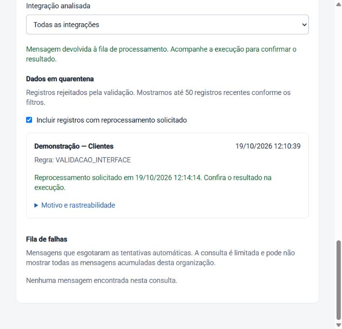

# Diagnóstico e reprocessamento pela interface

Entregue em **19/10/2026**, como continuidade das telas de Integrações.
Na página **Integrações**, consulte **Diagnóstico de falhas** abaixo do histórico de execuções.

## Uso

1. Atualize as falhas e, se necessário, selecione a integração analisada. Quarentena e fila
   de falhas têm estados de erro separados: indisponibilidade de uma não é exibida como
   ausência de problemas nem impede consultar a outra.
2. **Dados em quarentena** contém registros rejeitados pela validação. Abra motivo e
   rastreabilidade, confira a regra e corrija a causa na origem antes de reenviar.
3. **Reprocessar integração** abre uma confirmação explicando o alcance: uma nova leitura
   integral da origem, não apenas daquele registro. A operação preserva o watermark existente.
   Confirme para solicitar o trabalho assíncrono e acompanhe a execução destacada no histórico.
4. A marca `ResolvedAt` do contrato antigo é apresentada como **reprocessamento solicitado**.
   Ela registra o pedido, não prova correção. Ative **Incluir registros com reprocessamento
   solicitado** para consultar esse histórico. Se o dado continuar inválido, o novo lote pode
   gerar novas entradas. A tela não corrige automaticamente dados ou mapeamentos.
5. **Fila de falhas** lista mensagens encontradas na consulta da DLQ. Depois de corrigir a
   causa, **Tentar novamente** pede confirmação e devolve a mensagem ao Worker. Sair da DLQ
   ainda não significa sucesso: confira o resultado da execução.

A consulta da DLQ navega até 200 mensagens da fila compartilhada e filtra as do tenant.
Logo, lista vazia nessa consulta não comprova fila global vazia. Quarentena mostra até 50
entradas recentes após os filtros locais; as APIs existentes não oferecem paginação da
quarentena. A lista de falhas é atualizada manualmente, sem polling contínuo do broker.

`connector.view` permite consultar e `connector.manage` permite solicitar reprocessamento.
As ações continuam autorizadas pela API; esconder botões não substitui essa validação.
403/404/409 são tratados sem anunciar sucesso; 429 respeita `Retry-After` e bloqueia nova
tentativa durante a espera. A UI impede envio duplicado enquanto a ação está em andamento.

## Correções da API e do Worker

- Quarentena agora devolve **429 + Retry-After** quando a quota impede o pedido, sem marcar
  a entrada como solicitada. Antes, essa situação era convertida em 400 genérico.
- Entrada já marcada recebe **409**, evitando outra solicitação pelo mesmo registro já
  atendido. A quota por integração continua sendo a proteção concorrente existente;
  isso não introduz garantia transacional de exatamente uma publicação.
- A chamada de quarentena passa `SyncRequestedMessage.FullReprocessFromUtc` (limite mínimo
  de data) no campo existente de reprocessamento. O Worker reconhece esse limite reservado,
  não envia filtro incremental e não avança o watermark. Datas reais de reprocessamento por
  período continuam usando o caminho anterior; sincronização normal continua incremental.
- API e Worker precisam dessa atualização em conjunto para aplicar a semântica sem filtro;
  não houve mudança de campos do envelope, tabelas, permissões ou políticas RLS.
- O reenvio de DLQ mantém o ID da execução original; a quarentena cria uma execução nova.
  A interface usa o ID exato correspondente para destacar o pedido. Se estiver fora das
  50 execuções recentes, busca-o pelo endpoint individual existente e o inclui no histórico.

O reprocessamento de quarentena consulta a origem atual; não reproduz o objeto bruto antigo.
O nome histórico `ResolvedAt` foi preservado no banco/DTO para compatibilidade, com significado
explicitado na interface. Não há tela de edição de mapeamentos nesta entrega.

## Evidências

**76/76 testes da API**, **10/10 do conector** e **27/27 do frontend (15 arquivos)** aprovados.
Build de produção do frontend e publicações Release de Host/Worker passaram.
É revalidação dessas suítes, não uma nova execução de toda a solução.

Regressões cobertas: quota sem marcação falsa/publicação excedente, tenant alheio 404,
409 para pedido já marcado, mensagem de reprocessamento integral, ausência de filtro e
preservação do watermark; confirmação na UI, sessão de leitura sem escrita, falha parcial,
espera de quota, histórico solicitado e rastreio de execução fora da janela recente.
Os testes de retry/DLQ usam RabbitMQ real em containers descartáveis, como antes.

Ensaio adicional pelo navegador na Empresa Demo:

- Criados explicitamente **um registro de quarentena e uma execução Failed sintéticos**,
  identificados com `VALIDACAO_INTERFACE`, mais uma mensagem sintética na DLQ. Não foi
  provocada falha real na origem nem interrompido storage/broker para produzir o cenário.
  [Identificadores da fixture](../operations/falhas-ui-fixture-2026-10-19.json), sem credenciais.
- A mensagem de teste foi ajustada para o formato PascalCase do publisher, conferindo ID
  e tenant por AMQP antes de confirmar somente a mensagem sintética. Não houve purge da fila
  nem remoção de mensagens alheias. Ausência de motivo/data de dead-letter nessa fixture
  aparece como informação não fornecida, pois ela foi inserida diretamente na DLQ.
- Quarentena: ação e confirmação pela interface geraram outra execução, que concluiu com
  **6 recebidos, 6 aceitos, 6 atualizados, 0 rejeitados**, e watermark exatamente igual ao
  registrado antes. O histórico passou a mostrar reprocessamento solicitado.
- DLQ: ação e confirmação pela interface retiraram a mensagem da consulta; o Worker retomou
  a execução original e concluiu com **1 recebido/aceito/atualizado, 0 rejeitados**, sem erro.
  O resultado de um registro é esperado: essa mensagem segue o fluxo incremental normal.
- As evidências sintéticas de auditoria permanecem no banco. Não foram apagados registros
  de usuários ou dados comerciais para limpar o ensaio.

[Resultado estruturado](../operations/falhas-interface-2026-10-19.json).
Logs locais: `%TEMP%/eip-failures-api-tests.log`, `eip-failures-connector-tests.log`,
`eip-failures-final-ui-tests.log`, `eip-failures-final-ui-build.log`,
`eip-failures-host.log` e `eip-failures-worker.log`.

## Continuidade

Continuam pendentes paginação de históricos/falhas, localização consistente em pt-BR,
configuração/edição de conectores e reprocessamento por período pela interface.
Requisitos operacionais de segurança, privacidade e retenção permanecem nos relatórios
próprios; esta entrega não declara homologação de produção.
