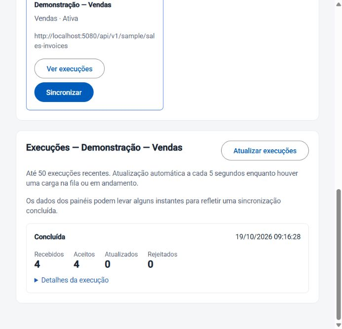
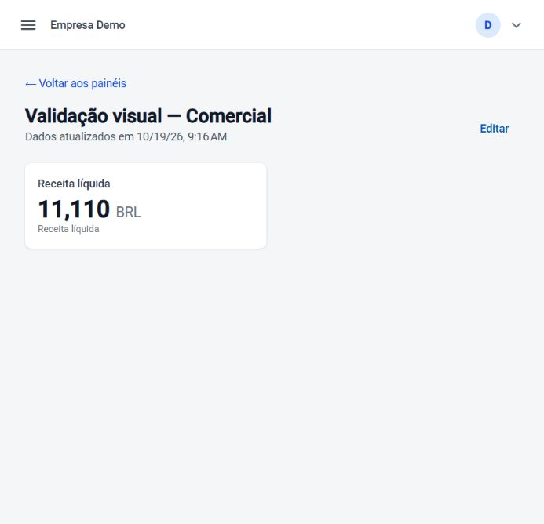

# Integrações pela interface

Entregue e validado localmente em **19/10/2026**, após o fechamento da Fase 3.
Abra **Integrações** no menu da aplicação, com a organização selecionada.

## Cadastro e sincronização

1. Informe nome, empresa, tipo de dado e endereço autorizado da origem. A empresa vem de uma
   lista da organização atual; não é necessário copiar identificadores do banco.
2. Cadastre a integração. Para a carga comercial inicial, configure clientes, produtos e vendas
   separadamente, nessa ordem: vendas precisa das referências de clientes e produtos.
3. Clique em **Sincronizar** e acompanhe **Execuções**. O aceite da solicitação ainda não significa
   conclusão: a execução passa por fila/processamento. O histórico atualiza a cada 5 s enquanto
   houver estado `Pending`/`Running`; também há atualização manual.
4. Confira recebidos, aceitos, atualizados e rejeitados. Os detalhes exibem ID/correlação para
   diagnóstico pelo operador. Uma falha de tentativa pode ser repetida pelo Worker; a tela não
   distingue retries esgotados ou presença na DLQ. Para esse diagnóstico, siga o
   [runbook operacional](conector-operacoes.md).
5. Consulte seu painel após a carga. A conclusão do sync pode aparecer alguns instantes antes
   do término da carga analítica; frescor no painel indica a última carga Warehouse registrada.

O excesso de sincronizações retorna 429; a tela exibe espera e bloqueia novo disparo durante
`Retry-After` (fallback de 60 s quando ausente/inválido). O Gateway agora expõe esse header às
origens CORS autorizadas. Não altera limites, permissões ou allowlist de destinos.

Histórico: até **50 execuções recentes** por integração na interface. Sem paginação de histórico
mais antigo nesta entrega. Recarregar a página preserva cadastros/execuções no servidor; selecione
novamente **Ver execuções**. Não há preferência local persistida do conector selecionado.

## Permissões e APIs

| Operação | Permissão / endpoint |
|---|---|
| Menu, listagem e histórico | `connector.view` |
| Cadastro e disparo | `connector.manage`; consulta de empresas requer `companies.view` |
| Integrações da organização autenticada | Novo `GET /api/v1/connectors` |
| Histórico de uma integração | Novo `GET /api/v1/connectors/{id}/sync-runs?limit=50` (1–100) |
| Empresas para seleção | Novo `GET /api/v1/tenants/{tenantId}/companies` |

A interface orienta pelos claims da sessão; a autorização real permanece na API. Listagem e
histórico usam contexto RLS e filtro de tenant. Histórico de conector alheio/inexistente retorna
404; empresas de outro tenant retornam 403. Não há leitura global, bypass RLS ou nova tabela.
Member pode consultar; Owner/Admin podem cadastrar/sincronizar conforme o mapeamento existente.

## Validação executada

**75/75 testes da API** e **21/21 do frontend (14 arquivos)** passaram; builds de Host,
publicação Release de Host/Gateway e build de produção do frontend passaram. Permanece aviso
Sass já existente. Não foi repetida a suíte inteira de 122 testes nesta entrega: o resultado
anterior está preservado, e aqui a revalidação de backend cobre a suíte completa da API.

Novos testes: isolamento A/B na lista, histórico e empresas; limite do histórico, anônimo 401,
403 sem permissões e usuário de leitura sem escrita. Frontend: resposta antiga não substitui
histórico de outro conector; quota respeita espera; leitura não envia sincronização; histórico
negado não é apresentado como lista vazia.

Ensaio real pelo navegador, na **Empresa Demo**, com cadastro e disparo das três origens:

| Origem | Recebidos / aceitos | Resultado |
|---|---:|---|
| Demonstração — Clientes | 6 / 6 | Concluída |
| Demonstração — Produtos | 5 / 5 | Concluída |
| Demonstração — Vendas | 4 / 4 | Concluída |

Nenhum rejeitado nessas execuções. A tentativa adicional de vendas retornou quota, com botão
bloqueado e mensagem de espera. O cadastro bem-sucedido limpa o formulário e o estado de envio,
evitando mensagens de campo obrigatório imediatamente após o sucesso. Os dados carregados são
dos endpoints de demonstração já existentes, não de um ERP externo.

O painel `Validação visual — Comercial` da Empresa Demo passou a mostrar **11110 BRL**, com
frescor presente. Não copiamos dados de outro tenant nem removemos painéis/cadastros anteriores.
As três integrações e seus dados de demonstração permanecem disponíveis para o usuário.
O formato de número/data ainda segue o locale atual do frontend; localização consistente
em pt-BR é uma melhoria separada.

Evidência resumida: [resultado](../operations/integracoes-interface-2026-10-19.json).
Logs locais: `%TEMP%/eip-connectors-api-tests.log`, `eip-connectors-final-tests.log`,
`eip-connectors-final-build.log`, `eip-connectors-host.log` e `eip-connectors-gateway.log`.

## Continuidade

Atualização posterior no mesmo dia: [diagnóstico e reprocessamento de falhas](falhas-interface.md)
entregues e validados pela interface. Quarentena/DLQ/requeue citados abaixo como pendentes
foram tratados nessa continuidade; os demais itens permanecem.

Quarentena/DLQ/requeue, reprocessamento por período, edição/desativação de conectores e visão
de histórico paginada continuam fora desta tela. As operações já existentes de quarentena/DLQ
permanecem via API/runbook. Próxima entrega recomendada: diagnóstico e reprocessamento de falhas
na interface, antes de expandir para conectores novos ou IA.
