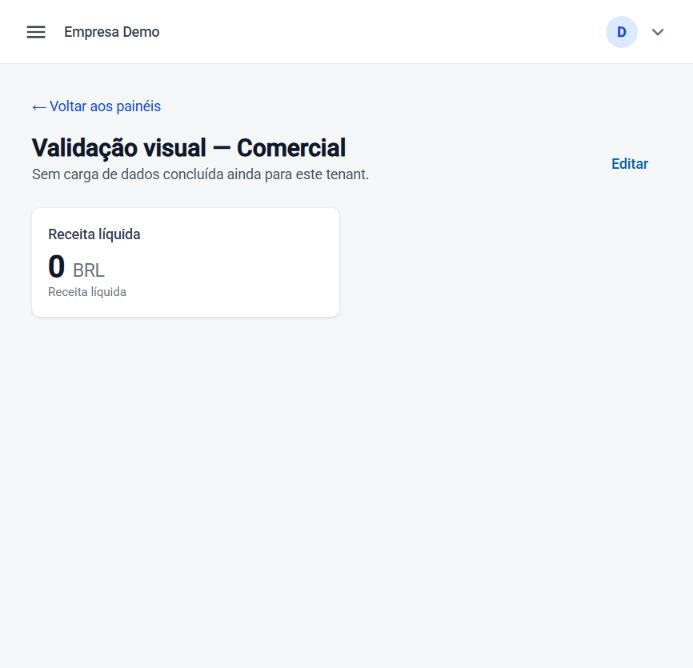

# Validação da interface — 19/10/2026

Registro da primeira validação visual. Posteriormente, no mesmo dia, foram entregues
[Integrações pela interface](../guides/integracoes-interface.md), e a Empresa Demo recebeu
dados de demonstração. As limitações de navegação/dataset vazio abaixo são históricas.

Navegador integrado, aplicação em `http://127.0.0.1:4200`, conta local de demonstração,
organização Empresa Demo. Interações reais pela interface, sem injetar sessão/token.

## Fluxos exercitados

- Login → início → lista de painéis.
- Criação de `Validação visual — Comercial`, inclusão de KPI de receita por mês,
  salvamento e publicação. Painel publicado:
  `278f810f-b46a-4fac-ab65-aff0927eb803`.
- Novo rascunho `Validação visual — Recuperação de rascunho`, criação seguida de reload
  no endereço de edição; nome e ID persistiram:
  `2879acdb-8aea-429f-9ad5-718b29f4501f`.
- Menu compacto abre como sobreposição e fecha após navegar. Conferência visual na
  janela estreita do navegador integrado, com painel ocupando a largura disponível.

## Problemas corrigidos

1. O menu lateral ficava sempre em modo lateral aberto e consumia grande parte da janela
   estreita. Agora usa sobreposição abaixo de 960 px, inicialmente recolhida, largura
   explícita e fechamento na navegação. Cabeçalho limita o nome da organização e recolhe
   o e-mail em larguras compactas. Modo lateral permanece previsto para desktop; resize
   amplo não foi exercitado nesta sessão.
2. Criar um rascunho mantinha `/dashboards/new`, embora o editor estivesse trabalhando com
   um ID persistido. Agora navega para `/dashboards/{id}/edit` com substituição da entrada
   do histórico. Atualizar a página recupera o rascunho em vez de voltar ao formulário novo.
   Teste de regressão acrescentado para esse caso.

Validação automatizada após as alterações: **17/17 testes, 13 arquivos**, e build de
produção aprovados. Permanece o aviso Sass `@import` já conhecido. Logs locais:
`%TEMP%/eip-visual-tests.log` e `%TEMP%/eip-visual-build.log`.

## Resultado visual e limites

O valor zero é esperado: Empresa Demo não tem carga Warehouse concluída, e a interface
mostra essa condição. Os 11.110,00 do ensaio anterior pertencem à organização sintética
de ingestão, não à Empresa Demo. Não foram copiados dados entre organizações para preencher
o painel. Painéis preexistentes foram preservados; os dois artefatos deste ensaio permanecem.

A interface atual só expõe início e painéis. Cadastro de conectores, disparo/acompanhamento
de sincronização, quarentena e DLQ continuam via API/runbooks. Portanto esta sessão valida
o fluxo visual disponível, **não uma jornada de ingestão integral sem sair da interface**.
Próxima lacuna funcional: telas de integração com permissões e escopo de tenant já existentes.
Registro/provisionamento de nova organização, logout, dispositivos adicionais e navegação
ampla em desktop não foram revalidados nesta sessão.
